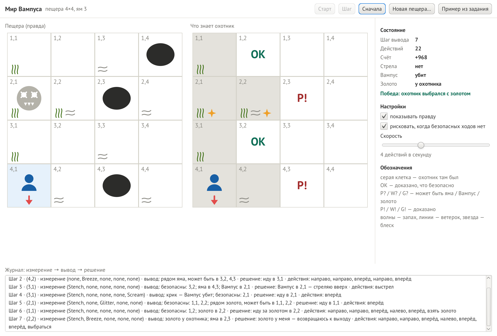
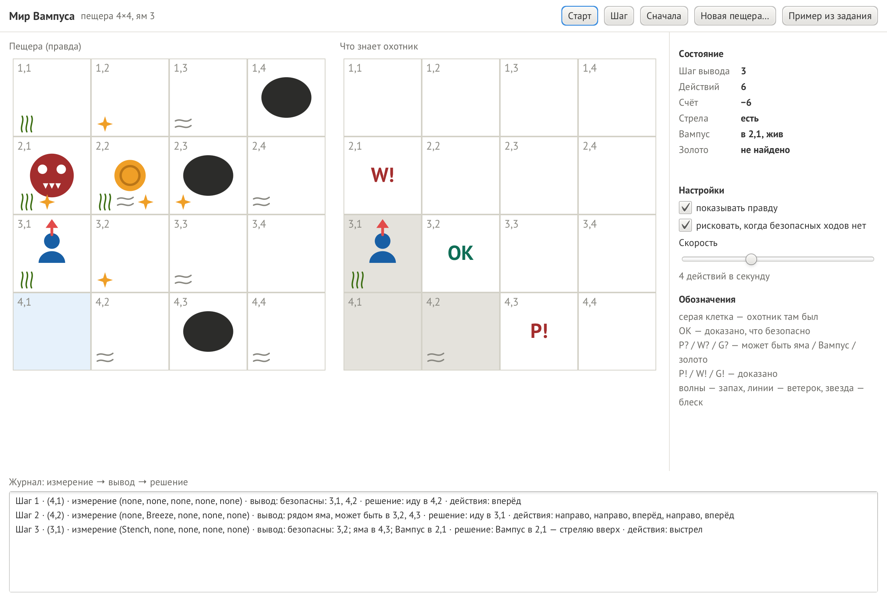
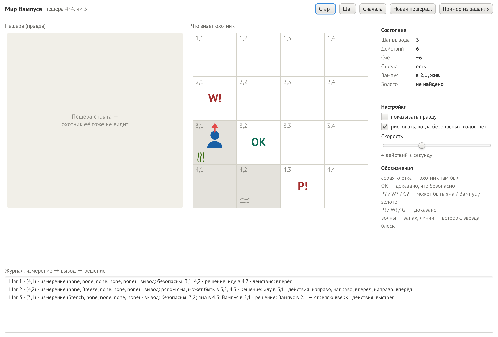
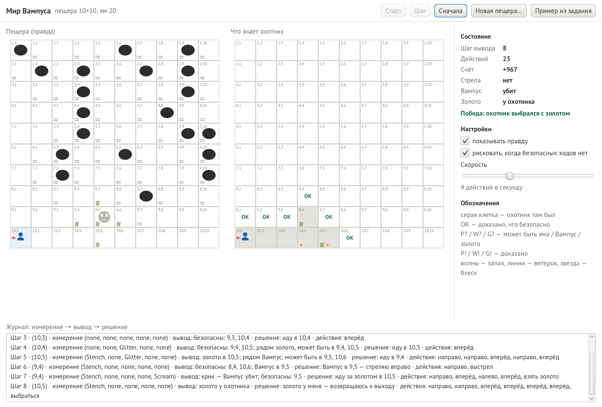
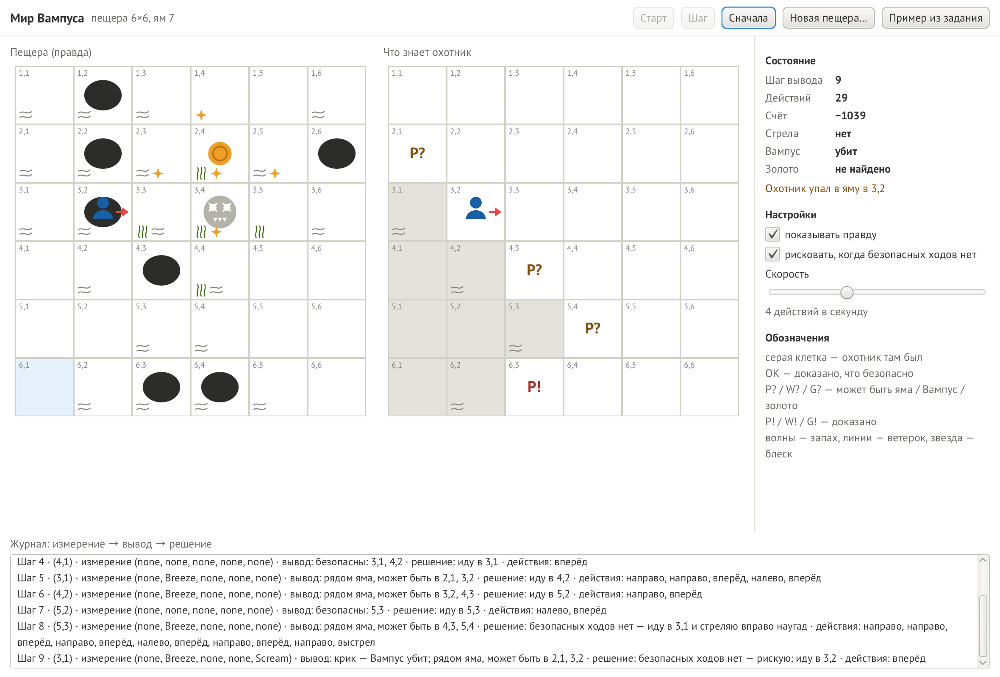
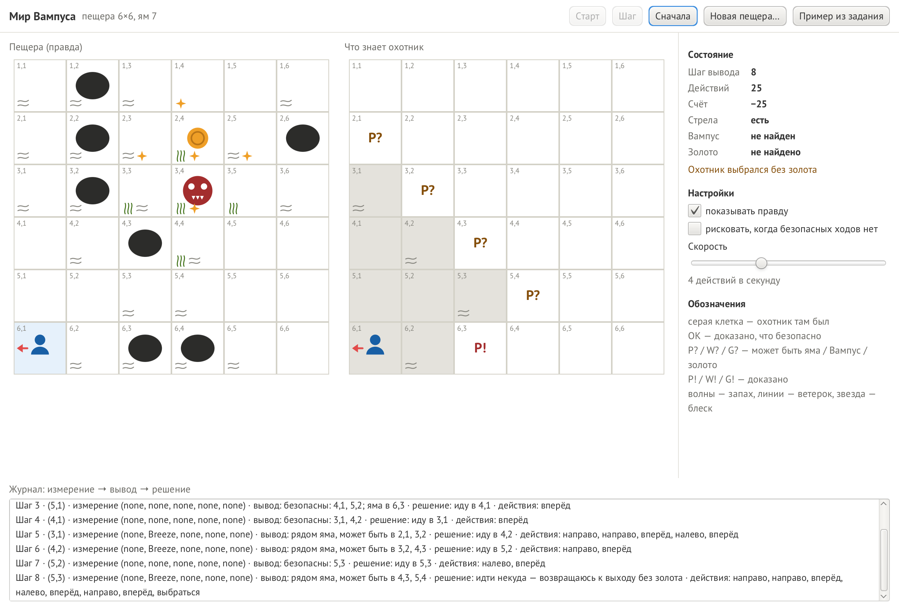
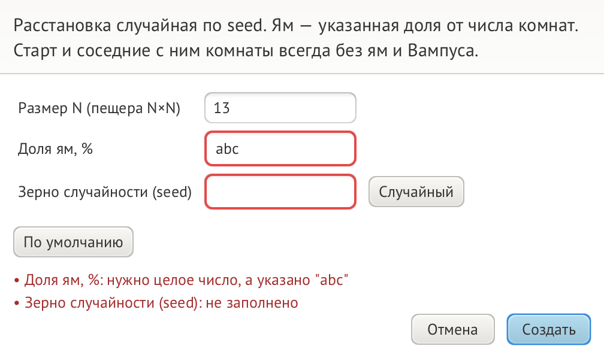

# Мир Вампуса

Лабораторная работа № 3 по курсу «ООП на языке Java»: агент, основанный на знаниях (World of Wumpus).

Пещера — поле N×N комнат. В ней Вампус (съедает всякого, кто войдёт в его комнату), ямы и золото,
которое Вампус сторожит в соседней комнате. Охотник карты не видит: он чувствует запах рядом с Вампусом,
ветерок рядом с ямой, блеск рядом с золотом, удар о стену и крик убитого Вампуса. Всё, что он почувствовал,
охотник записывает в **базу знаний** — набор логических предложений — и **логически выводит**, какие комнаты
безопасны, где яма и где Вампус. Программа показывает его представление о пещере на каждом шаге,
как таблицы в задании: `OK`, `P?`, `P!`, `W!`.



## Требования

- JDK 25
- Maven 3.9+. Отдельно ставить не обязательно: Maven встроен в IntelliJ IDEA.

Библиотеки (JavaFX 25.0.4, JUnit 6.1.3) Maven скачивает сам при первой сборке.

## Запуск

### Из IntelliJ IDEA

1. Откройте папку проекта. Если IntelliJ не предложил **Load Maven Project**,
   нажмите правой кнопкой на `pom.xml` → **Add as Maven Project**.
2. Вверху справа, в списке запусков, выберите **Окно** и нажмите ▶.
   Настройка лежит в папке `.run/`; в ней уже прописан флаг `--enable-native-access=javafx.graphics`,
   без которого Java печатает предупреждения при старте JavaFX.

### Из терминала

```bash
mvn javafx:run
```

## Правила мира

| Что | Как |
|---|---|
| Пещера | N×N, N от 4 до 12. Комната — (строка, столбец), (1,1) — левый верхний угол, как в задании |
| Старт | левый нижний угол (N,1), охотник смотрит вправо. Старт и соседние комнаты — без ям и Вампуса |
| Ямы | доля от числа комнат (по умолчанию 20 %): ям больше, чем больше пещера |
| Вампус | один, неподвижен; убивает, если войти к нему живому |
| Золото | одно, в комнате рядом с Вампусом. Взять можно только после того, как Вампус убит |
| Датчики | (Stench, Breeze, Glitter, Bump, Scream): запах — Вампус здесь или рядом, ветерок — яма рядом, блеск — золото здесь или рядом |
| Действия | шаг вперёд, поворот на 90° налево и направо, выстрел (стрела одна, летит по прямой до стены), взять золото, выбраться (только на старте) |
| Счёт | −1 за действие, −10 за выстрел, −1000 за смерть, +1000 за выход с золотом |

## Как охотник думает

В базе знаний с самого начала лежат правила мира: Вампус и золото ровно одни, золото рядом с Вампусом,
ни Вампус, ни золото не лежат в яме. После каждого измерения охотник добавляет предложения (TELL):

```
ветерок в 4,2            →  P(3,2) ∨ P(4,3) ∨ P(4,1)
ветерка в 4,1 нет         →  ¬P(3,1),  ¬P(4,2)
жив в комнате 4,1         →  ¬P(4,1),  ¬W(4,1)
выстрел вверх, крика нет  →  ¬W на всей линии полёта
```

Чтобы узнать, есть ли в комнате яма (ASK), охотник проверяет две вещи: можно ли согласовать с базой
«яма есть» и можно ли согласовать «ямы нет». Возможно только одно — факт доказан (`P!` или «ямы нет»),
возможно и то и другое — `P?`. Проверку выполнимости делает алгоритм **DPLL** с обучением на конфликтах:
перебирает значения, сразу выводит следствия и при противоречии запоминает его причину.
Найденная расстановка отвечает сразу на много вопросов, поэтому DPLL запускается не для каждого факта.

Пример из задания (Вампус в 2,1, ямы в 1,4, 2,3, 4,3); в скобках — действия, которыми выполняется решение:

| Шаг | Где | Измерение | Вывод | Решение |
|---|---|---|---|---|
| 1 | 4,1 | (none, none, none, none, none) | безопасны: 3,1, 4,2 | иду в 4,2 (вперёд) |
| 2 | 4,2 | (none, Breeze, none, none, none) | рядом яма, может быть в 3,2, 4,3 | иду в 3,1 (направо, направо, вперёд, направо, вперёд) |
| 3 | 3,1 | (Stench, none, none, none, none) | безопасны: 3,2; яма в 4,3; Вампус в 2,1 | Вампус в 2,1 — стреляю вверх (выстрел) |

На шаге 3 вывод собран из трёх шагов: ветерка в 3,1 нет — значит, яма из шага 2 в 4,3;
запаха в 4,2 не было — значит, Вампус не в 3,2, а в 2,1.

Цель охотник выбирает по порядку:

1. золото у него — к выходу;
2. Вампус убит и золото найдено — за золотом;
3. стрелы нет, а Вампус жив — к выходу (золото уже не взять);
4. Вампус найден — встать с ним на одну линию и выстрелить;
5. ближайшая непосещённая безопасная комната;
6. безопасных нет и риск разрешён — выстрел наугад туда, где может быть Вампус, иначе шаг в комнату, где яма не доказана;
7. иначе — к выходу без золота.

Ходит охотник только через комнаты, где уже был, путь — поиск в ширину с учётом поворотов.

## Управление

| Элемент | Что делает |
|---|---|
| **Старт / Пауза** | Охотник действует сам с выбранной скоростью. |
| **Шаг** | Одно действие охотника: поворот, шаг вперёд, выстрел, взять золото, выбраться. |
| **Сначала** | Та же пещера, охотник снова ничего не знает. |
| **Новая пещера…** | Размер N (4–12), доля ям (0–40 %), seed. |
| **Пример из задания** | Пещера 4×4 с картинки задания. |
| **показывать правду** | Скрыть настоящую пещеру: видно только то, что знает охотник. |
| **рисковать, когда безопасных ходов нет** | Без риска охотник в тупике сразу выходит и не погибает никогда. |
| **Скорость** | От 1 до 50 действий в секунду, шкала логарифмическая. |

Слева — настоящая пещера с подсказками датчиков, справа — карта охотника: серым — где он был,
`OK` — доказано безопасно, `P? / W? / G?` — может быть яма / Вампус / золото, `P! / W! / G!` — доказано.
Справа — номер шага вывода, число действий, счёт, стрела, что известно о Вампусе и золоте.
Внизу — журнал: строка на каждый шаг вывода, как в задании, — где охотник, что измерил, что вывел, что решил
и какими действиями решение выполняется. Охотник думает, как только пришёл в комнату, поэтому строка
и пометки на карте появляются в этот момент; при запуске в журнале уже есть шаг 1 про стартовую комнату.

## Защита от неверного ввода

В окне «Новая пещера» программа не падает и объясняет ошибку: пусто, буквы, дроби, `1e3`, `NaN`,
цифры других алфавитов (`٣`, `５`), слишком большие числа, управляющие символы. Проверяется и смысл:
размер от 4 до 12, доля ям от 0 до 40 %. Обо всех ошибках сообщается сразу, поля подсвечиваются,
окно не закрывается.

## Замер

1000 случайных пещер каждого размера, 20 % ям:

| Пещера | Побед (с риском) | Гибель (с риском) | Побед (без риска) |
|---|---|---|---|
| 4×4 | 70 % | 5 % | 64 % |
| 6×6 | 45 % | 6 % | 38 % |
| 8×8 | 28 % | 7 % | 23 % |

Без риска охотник не погибает ни разу. При полной карте почти все пещеры проходимы (99 / 99 / 96 %),
но на больших полях ветерок почти везде, и логика не может доказать безопасность ни одной новой комнаты:
из 231 проигрыша без риска на 8×8 в 227 охотник так и не нашёл Вампуса. Игра 6×6 занимает около 15 мс,
самое долгое действие на 12×12 — около 140 мс.

## Структура

```
src/main/java/wumpus/
├── Launcher.java             точка входа
├── model/                    мир, ничего не знает об охотнике и окне
│   ├── Position, Direction   комнаты и направления
│   ├── Action, Percept       действия и измерение датчиков
│   ├── Cave                  расстановка: Вампус, золото, ямы; пример из задания
│   ├── CaveSpec              заказ на случайную пещеру + проверка
│   ├── CaveGenerator         случайная пещера по seed
│   └── World                 среда: выполняет действия, выдаёт измерения, считает очки
├── logic/                    база знаний
│   ├── Fact, Literal, Clause предложения: P(3,2), ¬W(2,1), P(3,2) ∨ P(4,3)
│   ├── Rules                 правила мира и измерения → предложения
│   ├── KnowledgeBase         TELL / ASK, статусы фактов: нет / может быть / да
│   └── Dpll                  проверка выполнимости (DPLL с обучением на конфликтах)
├── agent/                    охотник
│   ├── Hunter                измерить → записать → спросить → решить; журнал
│   ├── Planner               путь по посещённым комнатам, повороты
│   └── CellKnowledge, Turn   что известно о комнате; строка журнала
├── controller/               логика окна без JavaFX
│   ├── GameController        старт, пауза, шаг (одно действие), скорость, новая пещера
│   ├── Marks                 пометки OK / P? / P! на карте охотника
│   ├── CaveForm              поля окна → CaveSpec
│   └── Texts, SpeedScale     строки состояния, слайдер ↔ скорость
├── view/                     окно JavaFX: WumpusApp, CaveCanvas, Icons, FormDialog
└── util/SafeText             безопасный показ ввода в сообщениях
```

## Документы

- [Отчёт (Word)](docs/report/Отчет_ЛР3_Минязов.docx) и [PDF](docs/report/Отчет_ЛР3_Минязов.pdf); собирается скриптом `docs/report/build_report.js`
- [Презентация](docs/presentation/Презентация_ЛР3_Минязов.pptx); собирается скриптом `docs/presentation/build_presentation.js`
- UML-диаграммы (PlantUML): `docs/uml`

## Тесты

```bash
mvn test
```

171 тест на JUnit 6, запускаются в случайном порядке. Главные проверки: шаги 1–3 из задания дают
ровно те же выводы и решения; DPLL сверяется с полным перебором на тысячах случайных формул;
всё, что охотник считает доказанным, совпадает с настоящей пещерой (240 случайных игр);
охотник погибает только после рискованного решения и никогда не идёт в доказанную опасность;
без риска не погибает ни разу. Логика кнопок, формы и пометок проверяется без открытия окна.

## Снимки

| Шаг 3 из задания | Пещера скрыта |
|---|---|
|  |  |

| Пещера 10×10 | Гибель после риска |
|---|---|
|  |  |

| Без риска: выход без золота | Ошибки в форме |
|---|---|
|  |  |
